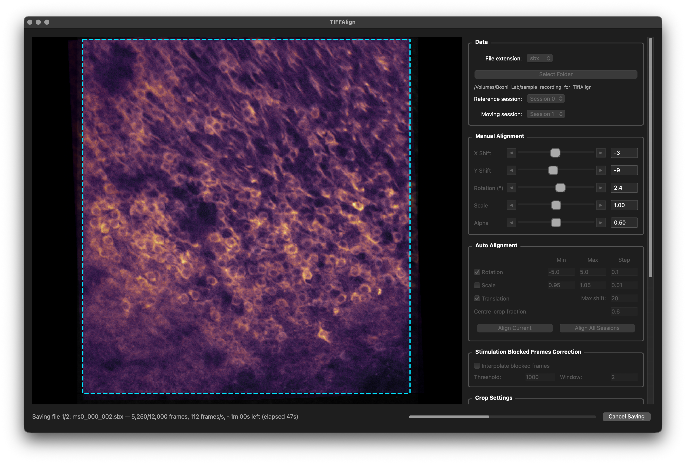
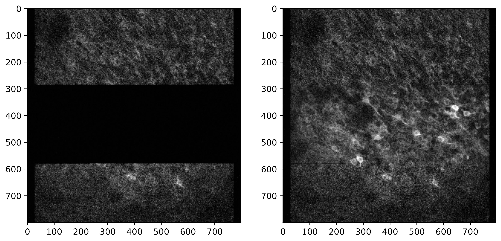

# TIFFAlign: Auto Alignment Across Imaging Sessions

[](https://doi.org/10.5281/zenodo.17499329)

This repository provides a **PyQt5-based GUI** for both automatic and manual alignment of one-photon / two-photon imaging sessions (`.sbx` or `.tiff` files). It allows interactive adjustment of **x/y shifts, rotation, scaling, and transparency**, can crop away borders that are not covered by every session, and saves the aligned sessions into a single concatenated TIFF stack.

Although many excellent automated motion correction algorithms exist, they are generally optimized for **within-session motion artifacts**. When working with **multiple sessions concatenated together**, shifts or rotations often occur between sessions. In these cases, we found that a manual **pre-alignment** step produces better results before applying automated motion correction. This little GUI was developed to streamline that process.



---

## Features

- Supports both `.sbx` and `.tiff` files
- Compute **mean frames** from the first N frames of each session (default 100, adjustable down to 1 = first frame only; cached with pickle for faster reloads)
- Select any session as the **reference session**
- Side-by-side layout: **live overlay preview** on the left, all controls on the right
- Interactive controls for X shift, Y shift, rotation, scaling and alpha (transparency)
  - Drag the slider, click the **◀ / ▶** buttons, use the **arrow keys**, or type a value
  - **Double-click** a slider to reset it to its default
  - The mouse wheel does not move sliders (scrolling scrolls the panel instead)
- **Auto alignment** with grid search (current session or all sessions)
- **Cropping** with sliders, plus **Auto Detect Crop** that keeps only the region imaged in every aligned session
- Save / load alignment parameters
- **Interpolate** 2P stimulation blocked frames
- Export aligned sessions as a concatenated **BigTIFF** file
  - Fast, memory-bounded, multi-threaded saving that handles very large recordings (hundreds of GB)
  - Progress bar with **estimated time left**, **cancel** at any time
  - Choose the **output folder**; free disk space is checked before writing starts
- Dark theme interface that looks the same on **macOS, Linux and Windows**


## Requirements and Installation

### 1. Clone this repository
```bash
git clone https://github.com/Bozhi-Wu/TIFFAlign.git
cd TIFFAlign
```

### 2. Create and activate a conda environment
```bash
conda create -n tiffalign python=3.11
conda activate tiffalign
```

### 3. Install dependencies
```bash
conda install pyqt=5 numpy=1.24 scipy=1.14 tifffile=2023 matplotlib -c conda-forge
```

---

## Usage

Run the GUI from the activated environment:

```bash
conda activate tiffalign
python TIFFAlign.py
```

For long saves on macOS, you can prevent the computer from sleeping with `caffeinate -i python TIFFAlign.py`.

1. Choose the **File Extension** (`sbx` or `tiff`).
2. Click **Select Folder** and choose a folder containing `.sbx` or `.tif`/`.tiff` files.
   - The files can exist in subfolders, as `rglob` is used to find them.
   - For the sessions to be concatenated in the correct order, name the files so that they sort correctly with Python's `sorted` function (e.g., by adding leading numbers like 000, 001, etc.).
   - For `.sbx` files, the corresponding `.mat` metadata files are also required.
   - The first time a folder is opened, the mean of the first N frames of each session is computed and cached in `mean_frames.pkl`. These mean frames are used for the preview, auto alignment and auto crop (the exported TIFF always contains every frame).
   - N is typed into the **Frames to average** box (whole number, default 100; 1 = first frame only). It can be set before selecting the folder. If a session has fewer than N frames, all of its frames are used.
   - The cache is recomputed automatically if the files in the folder, the selected extension, or N change.
   - Changing **Frames to average** after a folder is loaded (press Enter or leave the box) recomputes the mean frames and keeps the current alignment, reference/moving session and crop. Averaging is done in chunks, so large values do not require loading all those frames into memory.
   - A previously exported `tiff_aligned.tiff` is never treated as an input session.
   - If there is an existing alignment parameter file `params_all.pkl` in the folder, it is loaded automatically.
3. Pick a **Reference Session** and a **Moving Session**.
   - The reference session is shown in grayscale, while the moving session is overlaid using the *inferno* colormap.
   - Use the alpha slider to adjust transparency and better visualize the alignment.
   - When saving, the reference session remains unchanged; only the moving sessions are transformed.
4. Adjust parameters in the **Auto Alignment** section:
   - Use the checkboxes to select which parameters (rotation, scale, translation) are included in the search.
   - Set the **Min**, **Max** and **Step** for rotation and scale, and the **Max shift** for translation.
   - Since the edges of the imaging field can vary more between sessions and may not contain neurons, the **Centre-crop fraction** restricts the auto-alignment evaluation to the central region of the frame (default: 0.6).
5. Run auto alignment with **Align Current** or **Align All Sessions**.
6. (Optional) Fine-tune the alignment manually in the **Manual Alignment** section:
   - X Shift / Y Shift (±100 px), Rotation (±20°, 0.1° steps), Scale (0.50–1.50×), Alpha.
   - Each ◀ / ▶ click moves one step (hold to repeat); double-click a slider to reset it.
7. (Optional) Crop the output in **Crop Settings**:
   - Move the **Top / Bottom / Left / Right** sliders (or type values) to remove pixels from each side. The kept region is outlined in cyan on the preview, and the output size is shown below.
   - **Auto Detect Crop** finds the largest rectangle that contains only pixels imaged in *every* aligned session, so the output has no dark blanked borders and no empty wedges from rotation or shifts.
     - Dark blanked columns/rows (e.g., from resonant scanning, which sit at the detector offset rather than at zero) are detected per session from the mean frame and excluded.
     - After auto-detection, the crop keeps updating automatically whenever the alignment changes, until you move a crop slider by hand.
8. (Optional) Save alignment parameters with **Save Parameters** (and reload them with **Load Parameters**).
9. (Optional) Interpolate 2P stimulation blocked frames in **Stimulation Blocked Frames Correction**:
   - During 2P optogenetic stimulation, the PMT is often shuttered for a short period, producing horizontal “blocked” (dark) rows in the recording. To minimize the impact of these artifacts in downstream processing, you can optionally interpolate the blocked rows using the mean of the nearest clean rows from adjacent frames.
   - Blocked rows are identified by calculating their mean intensity and comparing it to a **threshold**. For `uint16` videos, the default threshold is 1000.
   - A **window** parameter defines how many frames before and after a blocked frame to search for clean rows (default: 2).
      - If both previous and next clean rows are found → the mean of the two is used.
      - If only one clean row is found → that row is used.
      - If no clean rows are found within the window → the row is filled with zeros.
   - **Check the checkbox** to apply interpolation during the saving process.



10. Export the aligned file with **Save Aligned TIFF**.
    - By default the file is written to the data folder. Use **Change...** next to *Output folder* to write it elsewhere (see [Performance](#performance-and-large-recordings)).
    - Before writing starts, the expected output size is compared with the free space on the output disk, and saving stops with a message if it will not fit.
    - The status bar shows the progress, throughput (frames/s) and an **estimated time left**.
    - Click **Cancel Saving** to stop at any time. The partially written file is deleted; any previously completed output file is left untouched.
    - The output is written to a temporary `tiff_aligned.tiff.part` file and only renamed to `tiff_aligned.tiff` once complete, so an interrupted save never leaves a truncated file under the final name.
    - The output TIFF uses the detected data type of the original files (`uint16` for `.sbx`) and is stored as a single `(frames, height, width)` BigTIFF series (one page per frame).

---

## Performance and large recordings

- **Memory use is bounded**, independent of recording size. Frames are read, corrected, aligned and written in chunks of ~256 MB, so only about 1 GB is held in memory at once. Recordings of hundreds of GB to ~1 TB can be exported on an ordinary workstation.
- **Saving is pipelined**: a background thread reads the next chunk from disk while the current chunk is transformed (multi-threaded) and written. Alignment uses a precomputed per-session lookup table that is bit-identical to applying scale → rotation → shift with nearest-neighbour interpolation frame by frame, but much faster.
- **The disk is usually the bottleneck.** For example, a USB external drive reading ~140 MB/s gives ~110 frames/s for 800 × 796 `uint16` frames, and the export runs at about that speed. More RAM does not speed this up.
- **Write to a different disk when possible.** Reading and writing on the same external drive makes the two compete for the same connection. Choosing an output folder on another fast disk (e.g., an internal SSD) can roughly halve the save time, provided it has enough free space (about the size of the input, minus any crop).
- `.sbx` files and uncompressed TIFFs are read via memory mapping. TIFFs that cannot be memory-mapped (e.g., compressed) are read page by page.
- exFAT and other modern file systems support very large output files; FAT32 does not (4 GB limit). Avoid disconnecting the drive or letting the computer sleep during a long save.

---

## Outputs

- `params_all.pkl` – Stored alignment parameters (in the data folder).
- `mean_frames.pkl` – Cached mean frames for faster reload (in the data folder).
- `tiff_aligned.tiff` – Exported aligned, concatenated BigTIFF (in the chosen output folder; defaults to the data folder).

---

## Citation

If you find **TIFFAlign** helpful in your research, please consider citing it as follows:

- Wu, B., & Josselyn, S. (2026). Bozhi-Wu/TIFFAlign. Zenodo. https://doi.org/10.5281/zenodo.17499329

This DOI always resolves to the latest release. To cite the exact version you used, see the version-specific DOIs on the [Zenodo record](https://doi.org/10.5281/zenodo.17499329).
